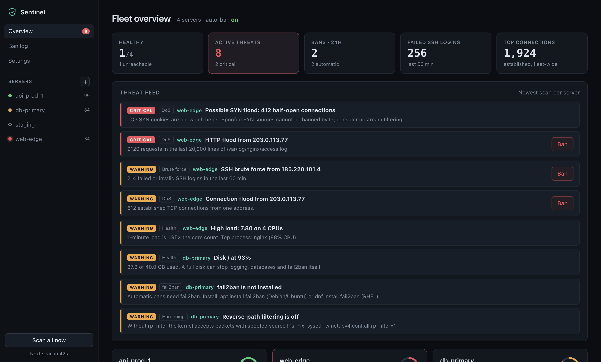
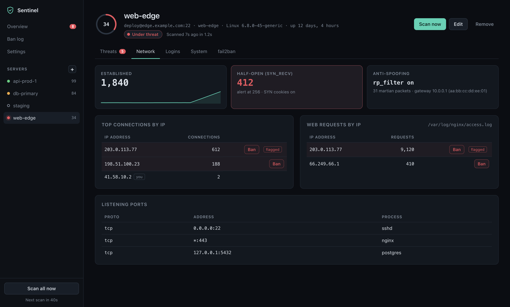

<div align="center">

# Sentinel

**Watch every Linux server you own from one desktop app. Spot attacks and send the attackers straight to fail2ban.**

[](https://github.com/PraiseKeyz/sentinel/actions/workflows/ci.yml)
[](LICENSE)




</div>

Sentinel signs in to your servers with the SSH key already on your machine. Every minute it checks their health and looks for brute force, floods, spoofing and signs of intrusion. When an IP crosses your thresholds, Sentinel bans it with fail2ban. Nothing needs to be installed on the servers beyond fail2ban itself.

> **Status:** early (0.1). Use it, break it, and [open an issue](https://github.com/PraiseKeyz/sentinel/issues).

## Features

| Area | What Sentinel checks |
|---|---|
| **Health** | Load per core, memory, swap, disk usage per mount, uptime, reboot-required, top processes |
| **Brute force** | Failed and invalid SSH logins per IP, distributed attacks from many IPs, root logins with a password |
| **DoS** | SYN floods (half-open sockets), connection floods per IP, HTTP floods from nginx, Apache or Caddy access logs |
| **Spoofing** | SSH host-key changes (man-in-the-middle), gateway MAC changes and duplicate MACs (ARP spoofing), martian packets, `rp_filter` and SYN cookies switched off |
| **Intrusion** | Extra UID-0 accounts, binaries running from `/tmp`, `/var/tmp` or `/dev/shm`, known crypto-miner names |
| **fail2ban** | Installed or not, jails, current and total bans |

On top of the checks:

- **A 0–100 score per server**, plus desktop notifications for new critical findings, bans and servers going offline.
- **Auto-ban** with fail2ban, optionally applied fleet-wide, and a ban log you can undo from.
- **Server import** from `~/.ssh/config`, with key files or your SSH agent.
- **Drill-down pages per server:** threats, top connections and web requests by IP, listening ports, logins, processes and jails.



## Getting started

Installers aren't published yet, so build and run from source for now. You need Node.js 22 or newer and [pnpm](https://pnpm.io).

```bash
git clone https://github.com/PraiseKeyz/sentinel.git
cd sentinel
pnpm install
pnpm dev
```

The first run downloads Electron (about 115 MB). When the window opens, click **+** next to *Servers*, enter the host and SSH user, pick your private key, and click **Test connection**.

### Server requirements

- Linux with `ss` (iproute2), plus `journalctl`, `/var/log/auth.log` or `/var/log/secure`.
- fail2ban, if you want bans: `apt install fail2ban` or `dnf install fail2ban`.
- A root login, or passwordless sudo for the SSH user. A narrow sudoers rule that covers log reading and banning:

```
# /etc/sudoers.d/sentinel  (edit with: visudo -f /etc/sudoers.d/sentinel)
deploy ALL=(root) NOPASSWD: /usr/bin/fail2ban-client, /usr/bin/journalctl, /usr/bin/tail, /usr/bin/ss, /usr/bin/test, /usr/bin/dmesg
```

The only check this rule doesn't cover is the scan for processes running from `/tmp`. That one needs full sudo (`NOPASSWD: ALL`) or a root login. Allowing `/bin/sh` would amount to full root anyway. Without any sudo, Sentinel still runs and tells you what it can't see.

## How auto-ban works

When an IP crosses a threshold (*Settings → Thresholds*), Sentinel runs `fail2ban-client set <jail> banip <ip>` on that server. It can optionally ban the IP on every server. It **never** bans:

- anything on your whitelist (IPs or CIDR ranges),
- your own IP, as each server sees it (`$SSH_CLIENT`),
- the IPs of the servers you monitor.

The same IP isn't re-banned on a server within 10 minutes. Every ban is recorded in the *Ban log*, where you can undo it.

## Security model

Sentinel holds SSH access to your servers, so it's built to be careful with it:

- **The probe is read-only.** It is plain POSIX `sh` that you can audit in [`electron/collector.ts`](electron/collector.ts). The only commands that change a server are `fail2ban-client banip` and `unbanip`, and every value put into them is validated first.
- **Pinned host keys.** Sentinel trusts a server's key on first contact. If the key changes later, it refuses to connect and raises a critical alert.
- **Secrets stay local.** Private keys are read from disk and never copied. Key passphrases are encrypted with the macOS Keychain or Windows DPAPI.
- **A sandboxed UI.** The renderer has no Node access and can only call a small, fixed IPC API.
- **Local settings.** They live in `sentinel.json` in the app's data folder: `~/Library/Application Support/Sentinel` on macOS, `%APPDATA%\Sentinel` on Windows.

Found a vulnerability? Please follow [SECURITY.md](SECURITY.md) instead of opening an issue.

## Development

```bash
pnpm dev           # Electron + Vite with hot reload
pnpm test          # parser and detection-rule tests
pnpm build         # type-check and bundle
pnpm exec vite     # UI only, in a browser, with demo data
pnpm screenshot    # regenerate the README screenshots in docs/
```

### Building installers

```bash
pnpm dist:mac      # .dmg for Apple Silicon and Intel → release/
pnpm dist:win      # NSIS .exe for x64 and ARM64     → release/
```

Build the Windows installer on Windows or in CI. Public releases need code signing: an Apple Developer ID with notarization, and a Windows code-signing certificate.

### Tech stack

Electron, React, TypeScript, Vite, [`ssh2`](https://github.com/mscdex/ssh2) and electron-builder. See [CONTRIBUTING.md](CONTRIBUTING.md) for how the code is laid out and how to add a detection rule.

## Roadmap

- [ ] Run the engine as a 24/7 service on a server, with the desktop app as its client
- [ ] Push-based agent for real-time detection on large fleets
- [ ] Slack, Telegram and email alerts
- [ ] Tray icon and launch at login
- [ ] Signed installers on GitHub Releases

## Contributing

Contributions are welcome: new detection rules, UI improvements, docs and bug reports. Start with [CONTRIBUTING.md](CONTRIBUTING.md), and please follow the [code of conduct](CODE_OF_CONDUCT.md).

## License

[MIT](LICENSE) © 2026 Comrac Softwares and Sentinel contributors
